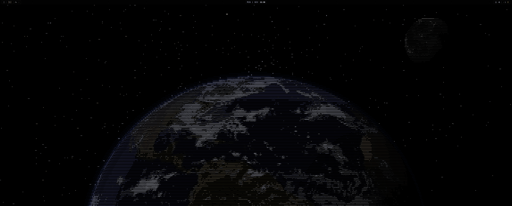
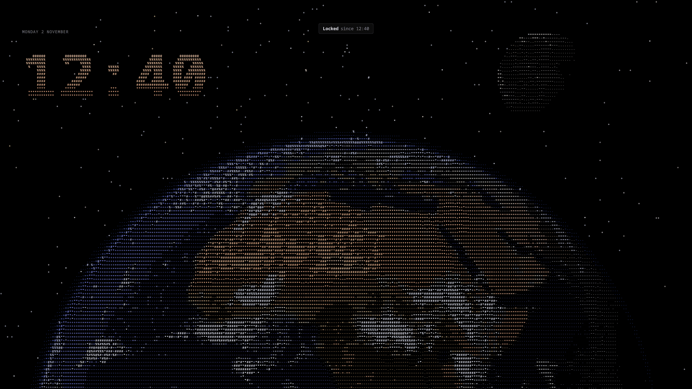
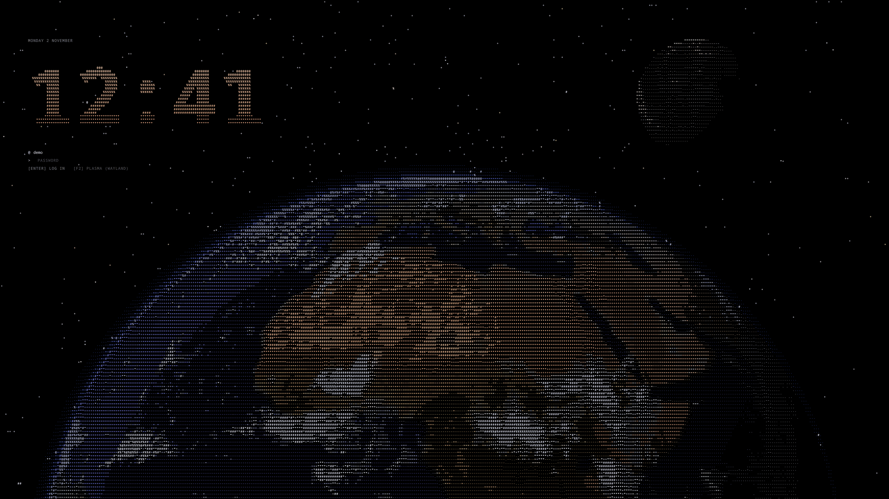
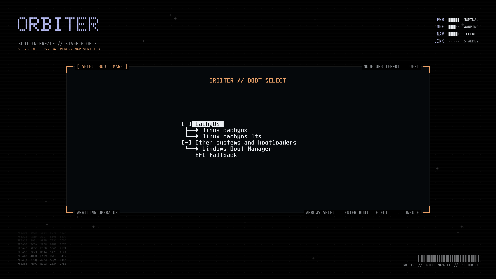
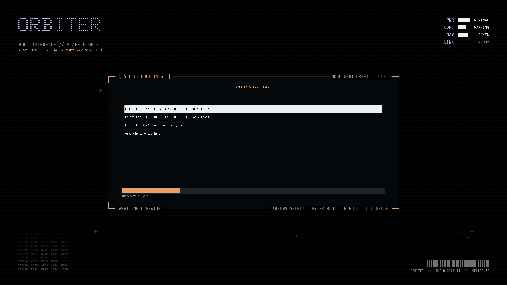
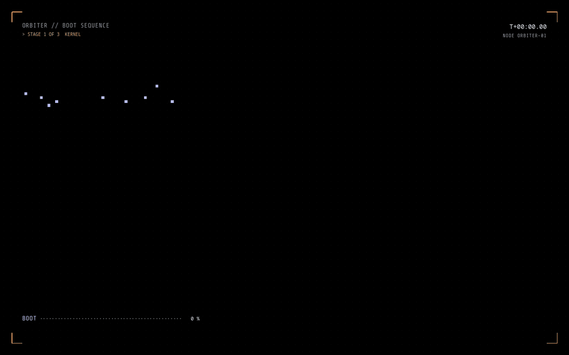
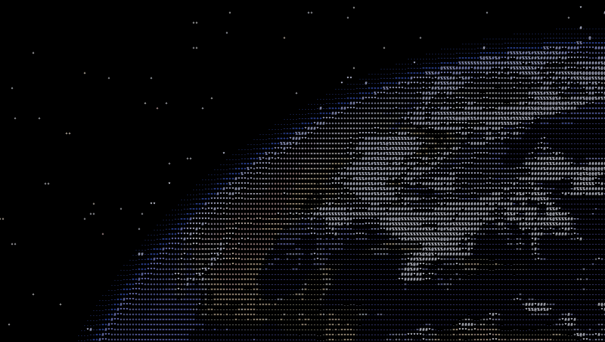
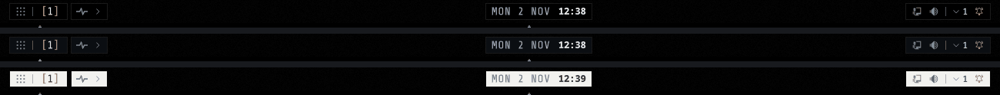

# Orbiter

A KDE Plasma 6 desktop theme built around an ASCII-art Earth. The planet,
the Moon and the real night sky are drawn as characters on the wallpaper,
lock screen and login screen. A top bar of square pills holds a system
dashboard, quick settings and a launcher, and the boot menu, boot animation
and Plasma splash match. It comes in three variants, Black, Dark and Pearl, which
switch live.

Made for CachyOS (or Arch) and Fedora 44 or later, with Plasma 6 on
Wayland. Inspired by
captianjonez's "KDE Plasma Orbiter"; see [NOTICE.md](NOTICE.md) for credits.



| Lock screen | Login screen |
|---|---|
|  |  |

| Boot menu (Limine) | Boot menu (GRUB) |
|---|---|
|  |  |

Boot animation (preview):



Up close, the planet is all characters:



The top bar in Black, Dark and Pearl:



MIT licensed ([LICENSE](LICENSE)). The bundled fonts and textures keep their
own terms, listed in [NOTICE.md](NOTICE.md).

## Install

On a machine already running Plasma 6:

```sh
sh bootstrap.sh <this repository's URL>
```

This installs chezmoi and git, clones the repository and asks about the
machine:

| Question | Default | What it does |
|---|---|---|
| Name on the boot screens | Orbiter | The brand in the boot menu and boot animation |
| Variant | black | Black, Dark or Pearl; switch later from the bar |
| Keep your existing taskbar | yes | Keeps your other panels, with an Orbiter background; no removes them |
| Lock screen | yes | Orbiter's lock screen (applies after logging out and back in) |
| Login screen | no | Installs the SDDM login theme (needs sudo) |
| Make SDDM the login manager | no | Only asked if you chose the login screen; applies at next boot |
| Boot theme | no | Limine or GRUB boot menu plus the Plymouth animation (needs sudo) |

It then installs the packages it needs (pacman or dnf asks first) and builds
everything. To change your answers, run `chezmoi init --prompt` and then
`chezmoi apply`. To pick up changes from the repository, run
`chezmoi update`.

### Without chezmoi

From a clone, everything goes through `./orbiter`:

```sh
./orbiter install            # wallpaper, lock screen, bar and splash
./orbiter theme black        # colours, Plasma style, fonts, Konsole, fish, fastfetch, splash
./orbiter lockscreen         # use the lock screen, then log out and back in
./orbiter taskbar remove     # optional: remove other panels (default: keep them)
sudo ./orbiter login         # optional: SDDM login screen
sudo ./orbiter boot          # optional: boot menu and animation
```

Run `./orbiter help` for the full list.

`sudo ./orbiter login` also gives the login screen your Plasma monitor layout,
and shows the prompt on your primary display. Run it again if you change your
monitors. If that display isn't plugged in, the prompt goes on the first one Qt
lists.

## Using it

- **Variant:** use the Design swatches in the bar's quick settings, or run
  `./orbiter theme black|dark|pearl`.
- **Launcher:** Meta+Space, or the grid icon at the top left.
- **Dashboard:** click the pulse icon in the bar.
- **Quick settings:** click the status pill at the top right. From there you
  can pick a Wi-Fi network, Bluetooth device or audio output, and right-click
  a background app for its menu.
- **Shell:** Orbiter never changes your login shell, and Konsole opens whichever
  one you use. Konsole's colours apply to any shell, and fish also gets matching
  syntax colours if it's installed.
- **fastfetch:** the theme installs a fastfetch config with the wallpaper's
  Earth as its logo, so CachyOS's fish greeting matches too. Any config you
  already had is kept as `~/.config/fastfetch/config.jsonc.orbiter-backup`,
  and `./orbiter theme --revert` puts it back.

## Plasma splash

`./orbiter theme` also selects Orbiter's splash, which shows between the login
screen and the desktop. The Earth, clock and date carry over from the login
screen, then fade to the wallpaper's Earth. It looks the same in every variant,
like the wallpaper. Your previous splash is remembered: `./orbiter theme --revert`
or `./orbiter uninstall` puts it back, unless you've picked another since. To
choose a different one, use System Settings > Colors & Themes > Splash Screen.

To preview it in a window after `./orbiter install`, run
`ksplashqml --test --window "$PWD/build/splash"`.

"Orbiter Splash" also shows up in System Settings' Global Theme list, as
splash-only packages do. It isn't a full theme, so don't pick it there; anything
it doesn't include falls back to Breeze.

## Customising

All colours, fonts, sizes and the brand name are in `tokens.toml`. For
changes that should apply to one machine only, put any of the same tables
and keys in `~/.config/orbiter/tokens.toml`; they're merged over the
defaults. chezmoi writes the brand there, so edit that file with
`chezmoi edit ~/.config/orbiter/tokens.toml`. After a change, run
`./orbiter install` and `./orbiter theme <variant>` again; for the boot
screens, also run `sudo ./orbiter boot`.

## Boot theme

`sudo ./orbiter boot` works out which bootloader the machine uses:

- **Limine:** themes the menu by changing only the global options at the top
  of `limine.conf`. The boot entries are never touched, and the file is
  backed up to `limine.conf.orbiter-backup` first. On CachyOS the
  initramfs is rebuilt with `limine-mkinitcpio`, which also updates the file
  hashes in `limine.conf`. Elsewhere, if your entries pin the initramfs by
  hash (`path#hash`), it stops, since nothing would update the hashes.
- **GRUB:** installs the theme to `themes/orbiter` in `/boot/grub` (Arch) or
  `/boot/grub2` (Fedora), points `/etc/default/grub` at it (backed up to
  `grub.orbiter-backup`) and regenerates `grub.cfg`, leaving the kernel options
  in your boot entries alone. On Fedora this needs
  `grub2-tools-extra` for `grub2-mkfont`. Fedora also hides the GRUB menu
  unless a boot fails: hold Shift at boot to see it, or show it every time
  with `sudo grub2-editenv - unset menu_auto_hide`.
- **Anything else** (systemd-boot can't be themed): installs only the
  Plymouth animation.

The animation needs Plymouth's script and label plugins, Plymouth in the
initramfs, and `splash` (or Fedora's `rhgb`) on the kernel command line. CachyOS
and Fedora set up the last two by default. On Fedora the plugins are separate
packages, `plymouth-plugin-script` and `plymouth-plugin-label`, which the chezmoi
setup installs. Without the label plugin, Plymouth crashes when it starts the
theme. The script checks the plugins before changing anything, and tells you if
either of the other two is missing.

### Secure Boot

The boot theme never touches an EFI binary, but two setups need re-signing
after it changes things, or the machine won't boot:

- **Unified kernel images (UKIs):** the initramfs, where the animation lives,
  is inside a signed image, so rebuilding it needs a re-sign.
- **Limine with its config enrolled:** `limine.conf`'s checksum is built into
  the signed Limine binary, so editing the config needs a re-enroll and a
  re-sign.

Both are handled automatically when **sbctl** manages your keys: CachyOS's
tooling and sbctl's hooks re-sign on every rebuild. UKIs are also fine when
ukify or dracut is set up to sign them itself. So with Secure Boot on,
`sudo ./orbiter boot` checks first, and stops before changing anything if
either setup is present without sbctl. If you sign some other way, run it with
`ORBITER_SECURE_BOOT_OVERRIDE=1` and re-sign before rebooting. When it
finishes on a Secure Boot machine with sbctl, it runs `sbctl verify` and
warns you not to reboot if anything is unsigned. An unsigned fallback loader
(`EFI/BOOT/BOOTX64.EFI`) that the machine doesn't boot from only gets a note. If
the install or uninstall fails or is interrupted after editing an enrolled
`limine.conf`, it re-enrolls the config before exiting, and tells you not to
reboot if that fails too.

If GRUB is set to enforce GPG signatures (`check_signatures=enforce`), the
GRUB menu theme is skipped, since GRUB would reject it, and only the
animation is installed. Plain shim-based Secure Boot, as Fedora sets it up,
needs nothing re-signed: shim checks the kernel, and the initramfs, `grub.cfg`
and theme files aren't checked at all. GRUB may still refuse to load the
theme's custom fonts there and use its own instead.

If you enrolled Limine's config by hand (`limine enroll-config`) rather than
through CachyOS's tools, the script can't tell. Re-enroll after installing,
before rebooting, or Limine will refuse the edited config.

To see what it found without changing anything, run
`./orbiter boot --check`; this works without sudo.

To preview the animation in a window first, without changing the boot setup,
run `sudo --preserve-env=DISPLAY,XAUTHORITY ./orbiter preview-boot`. That
needs Plymouth's X11 renderer, which Fedora doesn't ship; there,
`qml-qt6 dev/boot-animation.qml` plays a close copy instead.
`sudo ./orbiter uninstall-boot` undoes the boot theme.

### Testing the GRUB theme

The GRUB theme has been booted on Fedora, without Secure Boot. If you try it on
another setup, check that:

1. The menu sits inside the orange-cornered frame on the wallpaper, with
   `ORBITER // BOOT SELECT` (or your brand) above it.
2. The menu text is in a monospace font, not GRUB's default. If it isn't,
   `grub-mkfont` named the fonts differently than `theme.txt` expects. Check
   the `.pf2` files in `/boot/grub/themes/orbiter` (`/boot/grub2/...` on
   Fedora) against the font names in
   its `theme.txt`. With Secure Boot on, GRUB may also refuse custom fonts by
   design, so say whether it was on.
3. The highlighted entry is a bright bar with an orange left edge.
4. An orange countdown bar runs below the menu, with `AUTO-BOOT IN N S`
   under it.

A photo of the screen helps most. `sudo ./orbiter uninstall-boot` restores
the previous GRUB setup.

## Removing it

```sh
sudo ./orbiter uninstall-boot   # if the boot theme is installed
./orbiter uninstall             # wallpaper, lock screen, bar and splash
./orbiter theme --revert        # back to Breeze Dark, default fonts, your fastfetch config and splash
```

## Layout

| Path | Contents |
|---|---|
| `orbiter` | The command everything runs through |
| `tokens.toml` | Design tokens: colours, fonts, sizes, brand |
| `src/scene/` | The ASCII scene: QML, shaders and textures, shared by the wallpaper, lock, login and splash screens |
| `src/packages/` | The Plasma wallpaper, lock screen, bar and splash, and the SDDM theme |
| `src/theme/` | The generator for the colour schemes, Plasma style and Konsole; fonts; fish colours; the fastfetch config |
| `src/boot/` | Generators for the Limine, GRUB and Plymouth themes, and the config editors |
| `scripts/` | The install and uninstall steps `./orbiter` runs |
| `chezmoi/` | chezmoi's source: setup questions and run scripts |
| `dev/` | Previews in a window: `qml6 dev/scene.qml` (`qml-qt6` on Fedora), `dev/lockscreen.qml`, `dev/boot-animation.qml` |
| `tools/` | Scripts that produced the textures and the fastfetch logo |
